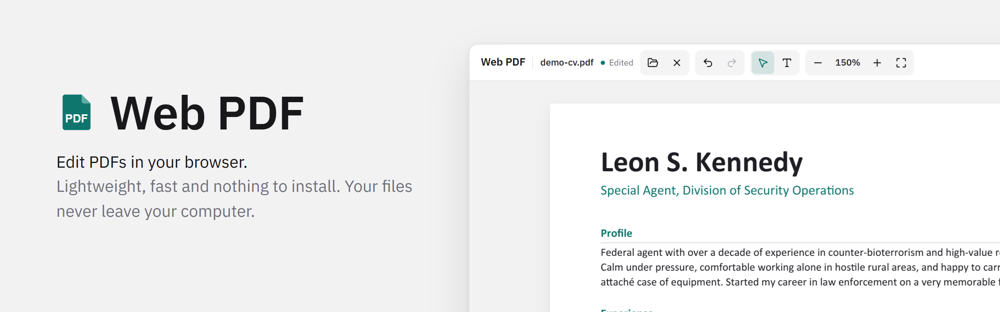
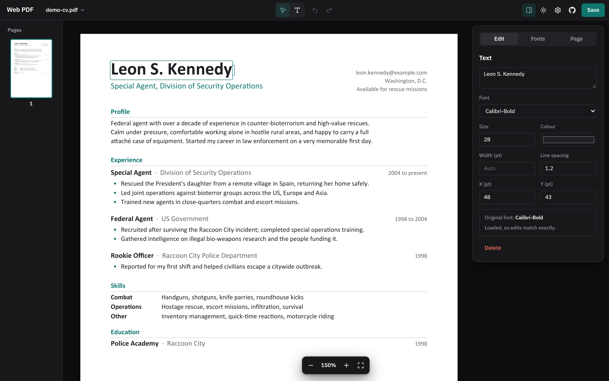
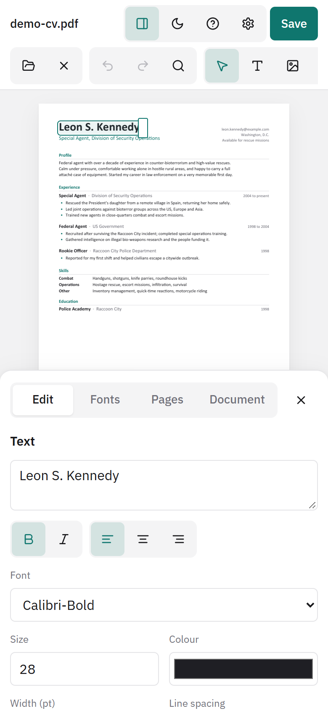

<div align="center">

<picture>
  <source media="(prefers-color-scheme: dark)" srcset="docs/images/header-dark.png">
  
</picture>

A PDF editor that runs in your browser. Files are edited locally and never uploaded.

[](https://github.com/jacoobia/web-pdf/actions/workflows/ci.yml)
[](LICENSE)
[](https://react.dev)
[](https://www.typescriptlang.org)
[](https://bun.sh)

[Features](#features) · [Browser support](#browser-support) · [Getting started](#getting-started) · [Deploying](#deploying) · [Contributing](#contributing)

</div>

<table>
  <tr>
    <td width="74%"></td>
    <td width="26%"></td>
  </tr>
  <tr>
    <td align="center"><sub>Desktop</sub></td>
    <td align="center"><sub>Phone</sub></td>
  </tr>
</table>

## Features

- Edit existing text in place. Edits are drawn in the PDF's own font when it's available.
- Add new text boxes that wrap to a width you set.
- Move, copy and delete text and images, with snapping to nearby text.
- Add headers and footers with page numbers.
- Undo, redo, multi-select and a right-click menu.
- Light and dark themes, and a layout that works on phones.

### How it works

| | |
| --- | --- |
| Reading and rendering | [MuPDF](https://mupdf.com), in a web worker |
| Writing new text | [pdf-lib](https://pdf-lib.js.org) |
| Saving | Only the text you change is redrawn; the rest of the file is kept as it was. |

## Browser support

| | Chrome, Edge | Firefox, Safari |
| --- | :---: | :---: |
| Edit and save PDFs | ✓ | ✓ |
| Save back over the original file | ✓ | Saves as a download |
| Load fonts installed on your computer | ✓ | |

<sub>Tested in Chrome and Brave.</sub>

## Getting started

Requires [Bun](https://bun.sh) 1.2 or newer.

```sh
git clone https://github.com/jacoobia/web-pdf.git
cd web-pdf
bun install
bun run dev
```

| Command | Description |
| --- | --- |
| `bun run dev` | Start the dev server |
| `bun run build` | Typecheck and build to `dist/` |
| `bun run lint` | Lint and check formatting |
| `bun run format` | Fix lint and formatting issues |
| `bun run typecheck` | Run the TypeScript compiler |
| `bun run test` | Run the end-to-end checks (Windows only) |

## Deploying

`bun run build` produces a static site in `dist/` that any static host can serve. Serve it over HTTPS, as saving to files and reading installed fonts only work on secure pages.

Web PDF is licensed under the AGPL, so a hosted copy has to offer its source code to its users. The app links to this repository; if you host a modified version, point `REPO_URL` in `src/components/EditorTools.tsx` at your fork.

## Contributing

See [CONTRIBUTING.md](CONTRIBUTING.md).

## Licence

[AGPL-3.0-or-later](LICENSE). Copyright (C) 2026 Jacob Hampton.
